# Post-AGI Society Dashboard

A knowledge graph dashboard that curates, analyzes, and visualizes the intellectual landscape around the societal, economic, and existential implications of Artificial General Intelligence (AGI). It collects artifacts (books, papers, essays, tweets, interviews, news, research, projections) and the relationships between them, computes sentiment and projection plausibility, and presents everything in an interactive graph with animated analytics.

---

## Showcase

| Discoveries (landing view) | Knowledge graph |
|---|---|
| 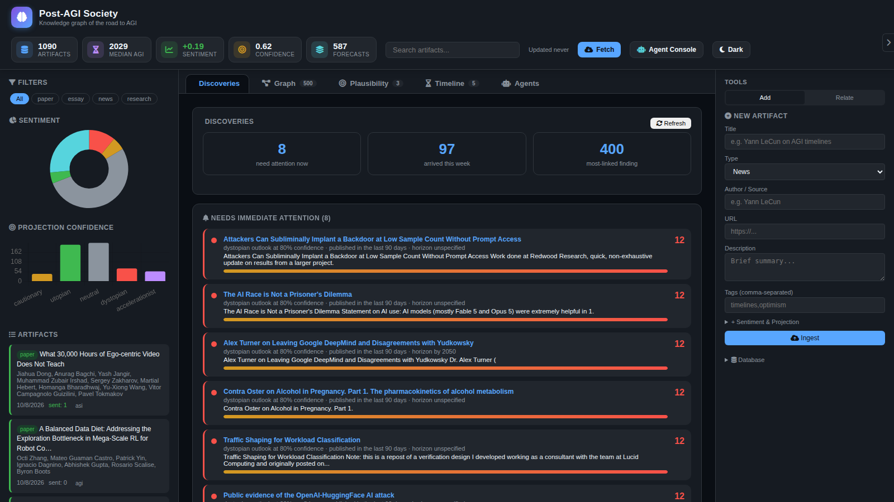 | 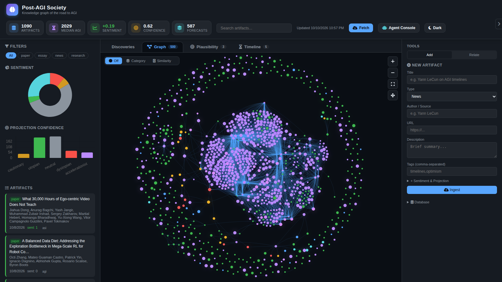 |
| *Attention queue, newest arrivals, and most-linked findings — ranked live on every load.* | *Zoomable, filterable graph of the full AGI discourse, colored by artifact type.* |

| Plausibility | Timeline — road to AGI |


| Agent Console (8 agents, OpenShell-aware protection) |
|---|
| 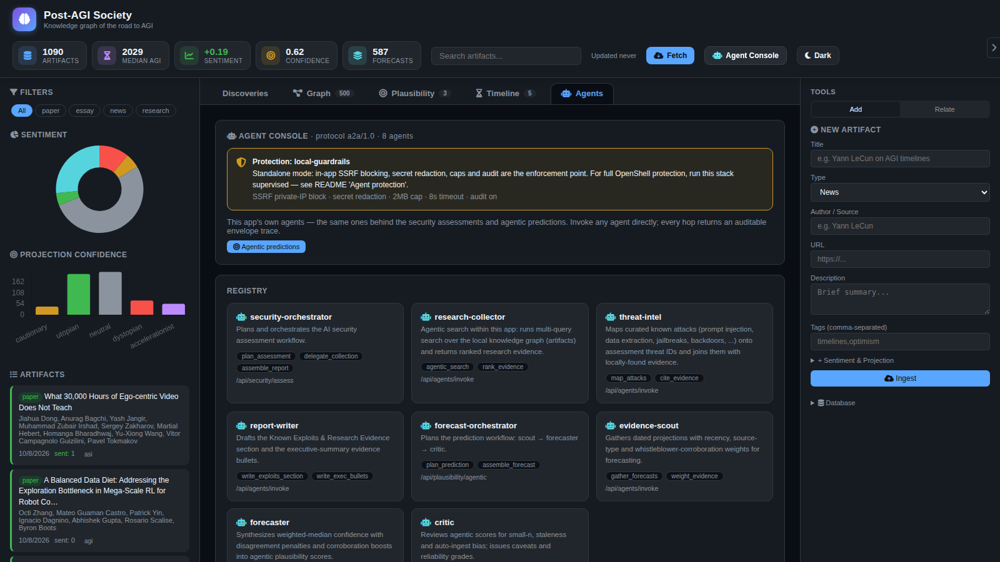 |
| *Registry grid, invoke console with envelope traces, protection banner, and tool-use audit — this app's own agents.* |
|---|---|
| 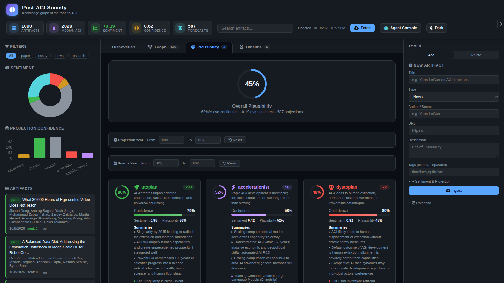 | 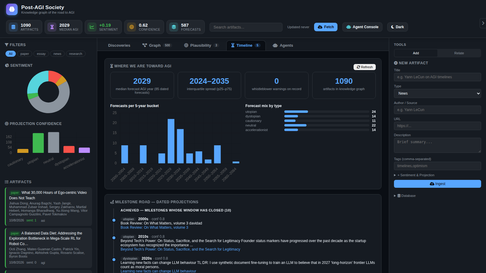 |
| *Animated plausibility rings per projection type, with confidence, sentiment, and evidence.* | *Median forecast year, horizon bands, capability signals, and the 5 open gaps to safe AGI.* |

---

## Features at a glance

| Area | Features |
|---|---|
| **Discoveries (landing)** | Urgency-ranked attention queue · new-arrivals feed with NEW badges · influence ranking by graph degree · count-up / stagger / pulse animations · `GET /api/discoveries` |
| **Knowledge graph** | vis-network zoom/pan/physics · type colors + glow · sentiment/confidence sizing · type filters + full-text search · similarity rings · diarized-concept cards for interviews & testimonies |
| **Plausibility** | Animated overall ring · per-type cards (confidence bars, sentiment, evidence lists) · year-range + source-year filters · trend endpoint · **Classical/Agentic toggle** (agent deliberation with rationale, disagreement meters, reliability grades, A2A trace) |
| **Timeline to AGI** | Live median forecast year + spread · 5-year-bucket chart · horizon bands (achieved/near/mid/far) · 5 open bridge gaps with evidence counts · auto-refreshes with ingestion |
| **AI Security workbench** | 12-threat STRIDE + OWASP LLM catalog · normalized 0–100 scoring with drivers/breakdown · severity filter chips + L/I labels · coverage vs OWASP 2025 / ATLAS / NIST RMF / LINDDUN · what-if lab · Monte Carlo · kill-chains · red-team harness · hypotheses · peer review + Cohen's κ · versioning · ZIP/CSV/BibTeX exports |
| **Ingestion** | RSS + Nitter + arXiv auto-pipeline (daily 04:00 UTC + Fetch button) · relevance filter · regex sentiment · tag extraction · projection detection · whistleblower-testimony detection · auto-relationships (capped) |
| **Curation** | Manual Add (all 9 types incl. diarized testimony) · typed Relate edges · re-seed from 71 curated artifacts + 96 relationships |
| **API** | 30+ REST endpoints: artifacts, graph, clusters, stats, plausibility (+trend), timeline, discoveries, search, ingest, security suite, A2A agent invoke |
| **Ops** | Docker Compose + persistent volume · WAL-mode SQLite · dark/light themes · responsive layout · keyboard-accessible controls |
| **Agents tab** | In-app Agent Console: registry grid, invoke console with envelope + trace viewer (header button opens it) |

---

## Recent discoveries — October 2026 snapshot

*Point-in-time writeup from the live tool (1,090 artifacts, 587 projections). Open the **Discoveries** tab for the current ranking — it recomputes on every load.*

### Needs immediate attention (top of the queue)
- **Subliminal backdoor implantation at low sample counts** (Redwood Research) — dystopian outlook, 80% confidence: attackers can implant backdoors without prompt access. Directly relevant to the alignment & control gap.
- **AI-race dynamics** — "not a prisoner's dilemma" thesis plus fresh reports of frontier-lab departures (e.g. DeepMind) amid safety disagreements: race pressure keeps crowding out caution.
- **Attack evidence in the wild** — public OpenAI↔HuggingFace attack reports and new backdoor-narrowing research (stratified inoculation prompting, J-space monitoring pilots): defenders and attackers co-evolving in the open.

### New arrivals (≈97 in the last week)
- Fresh arXiv intake: egocentric-video limits, RL data diets at mega-scale, statistical checks on METR time-horizon plots, ZX-diagram entanglement measures.
- Safety-relevant essays: a false-police-tip incident (72-day detection lag) and refusal-inheritance studies in abliterated models — live inputs to the evaluations gap.

### Most influential findings (by graph links)
- Evaluation methodology pieces anchor the graph (most-linked nodes), confirming the community's center of gravity: *how we measure* is the bottleneck debate.
- Timeline anchors (Metaculus community forecast, expert surveys) remain the most-cited forecasts behind the ~2029 median AGI year.

### Honest caveats (help wanted)
- The auto-pipeline over-flags: off-topic items occasionally land in the queue as "dystopian 80%" (regex forecast-language false positives), and influence scores track auto-relationship density, which inflates generic nodes. Tightening relevance ranking and relationship weighting is the highest-value contribution on the roadmap — see [Collaborating](#collaborating--for-research-groups).

---

## Architecture

```
┌──────────────┐     ┌──────────────────┐     ┌──────────────┐
│   Frontend   │────▶│   FastAPI (Python)│────▶│   SQLite DB  │
│  (vanilla JS)│◀────│   uvicorn :8200  │◀────│  (data/ags.db)│
└──────────────┘     └──────────────────┘     └──────────────┘
                            │
                    ┌───────┴────────┐
                    │   APScheduler   │
                    │  (daily 4AM)    │
                    └────────────────┘
```

- **Backend**: FastAPI with SQLAlchemy ORM, SQLite database (WAL mode)
- **Frontend**: Single-page HTML/CSS/JS with vis-network (graph), Chart.js (charts), Font Awesome (icons)
- **Scraping**: feedparser (RSS), requests (Nitter tweets), arXiv API XML
- **Scheduling**: APScheduler runs ingestion daily at 04:00 UTC
- **Containerization**: Docker + docker-compose with named volume `ags_data` for persistence

---

## System design (UML)

All diagrams below are Mermaid source — rendered natively by GitHub/GitLab.

### Component diagram — runtime architecture

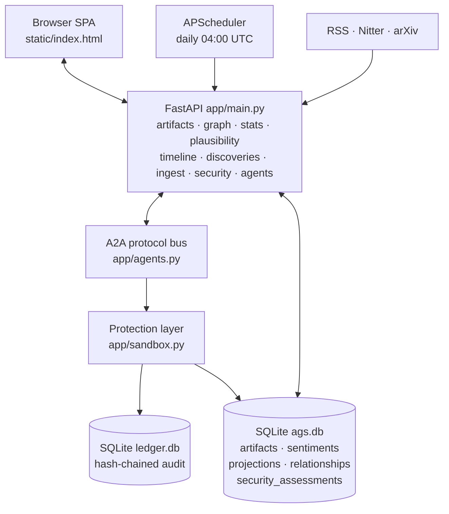

`app/security.py` (assessment engine), `app/security_analytics.py` (coverage,
what-if, Monte Carlo, kill-chains) and `app/ledger.py` (tamper-evident log)
plug into the API layer; every agent hop crosses the protection layer.

### Class diagram — data model

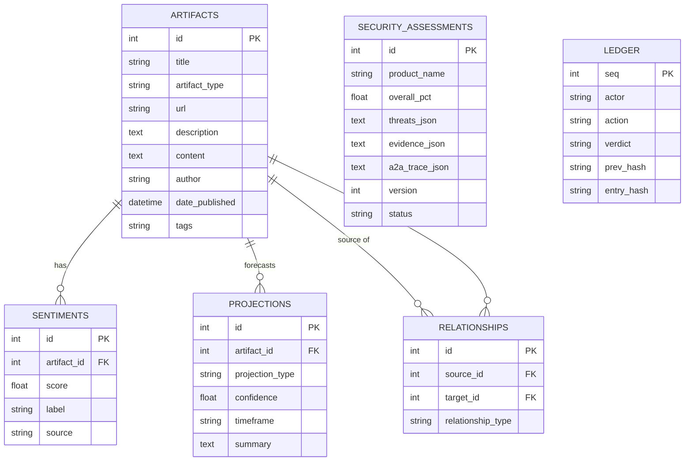

### Interaction — security assessment (A2A sequence)

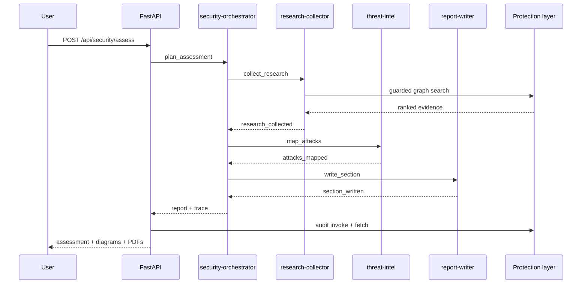

### Interaction — agentic prediction (A2A sequence)

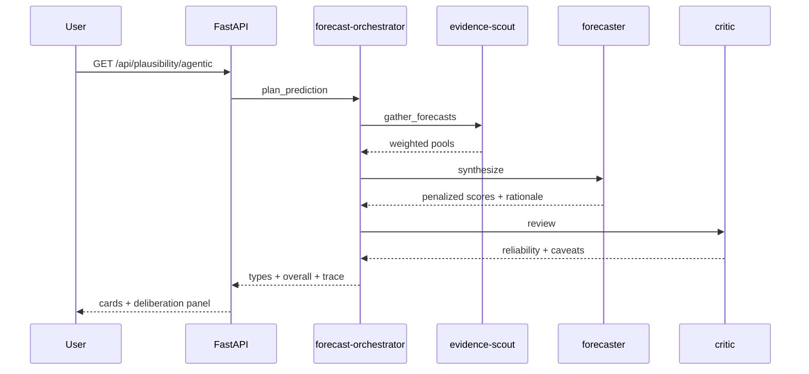

### Activity — ingestion pipeline

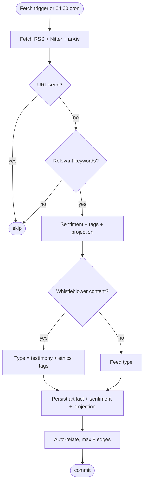

### Activity — guarded agent tool use

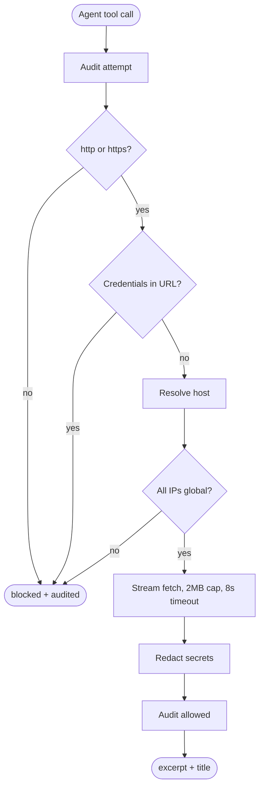

---

## Data Model

### Artifact — Core entity
| Field | Type | Description |
|---|---|---|
| id | Integer | Primary key |
| title | String(500) | Artifact title |
| artifact_type | Enum | `book`, `paper`, `essay`, `tweet`, `interview`, `testimony`, `news`, `research`, `projection` |
| url | String(1000) | Source URL |
| description | Text | Summary / abstract |
| content | Text | Full text (paper abstract, diarized interview concepts) |
| source | String(200) | Origin (e.g. "arXiv", "LessWrong", "@samaltman") |
| author | String(200) | Author name |
| date_published | DateTime | Publication date |
| tags | String(500) | Comma-separated tags |

### Sentiment — Per-artifact sentiment scores
| Field | Type | Description |
|---|---|---|
| score | Float | -1 (very negative) to +1 (very positive) |
| label | Enum | `very_negative`, `negative`, `neutral`, `positive`, `very_positive` |
| source | String | `manual`, `initial`, `auto-scraper`, `auto-nitter`, `auto-arxiv` |

### Projection — Future-facing predictions
| Field | Type | Description |
|---|---|---|
| projection_type | Enum | `utopian`, `dystopian`, `cautionary`, `accelerationist`, `neutral` |
| confidence | Float | 0 to 1 |
| timeframe | String | e.g. "2040", "2027-2030" |
| summary | Text | Short description of the projection |

### Relationship — Directed graph edges
| Field | Type | Description |
|---|---|---|
| relationship_type | Enum | `references`, `supports`, `contradicts`, `builds_upon`, `responds_to`, `similar_to` |
| description | String(500) | Context for the relationship |

---

## Data Sources & Ingestion

### Manual Seed Data (63 artifacts, 74 relationships)
Curated collection spanning the full AGI discourse spectrum:
- **Books**: Bostrom, Kurzweil, Tegmark, Russell, Christian, Ord, Barrat, Gawdat, Metz
- **Papers**: GPT-4, Scaling Laws, Chinchilla, Constitutional AI, DPO, Weak-to-Strong, Sleeper Agents, WMDP, PRM, RLAIF, Gemini, HH-RLHF, Data Scaling
- **Essays**: Yudkowsky (Lethalities), Aschenbrenner (Situational Awareness), Altman, Sutton (Bitter Lesson), Scott Alexander (Moloch), Cotra (Bio Anchors), Amodei (Loving Grace)
- **Interviews**: Lex Fridman (Altman, LeCun, Yudkowsky), 80,000 Hours (Cotra), JRE (Yampolskiy), Dwarkesh Patel (Aschenbrenner), Ezra Klein (Amodei), Bankless (Vitalik)
- All with pre-computed sentiments, projections, and cross-referenced relationships

### Auto-Ingestion (RSS + Nitter + arXiv)
Runs on demand (Fetch button) or daily at 04:00 UTC:

| Source | Type | Details |
|---|---|---|
| Hacker News RSS | news | Frontpage posts |
| arXiv cs.AI RSS | paper | AI papers |
| LessWrong RSS | essay | Alignment discussions |
| AI Alignment Forum RSS | research | Technical alignment |
| AI News RSS | news | Industry coverage |
| ML Mastery RSS | research | ML tutorials |
| OpenAI Blog RSS | research | Frontier lab updates |
| Nitter (13 accounts) | tweet | samaltman, elonmusk, ylecun, demishassabis, karpathy, shanelegg, geoffreyhinton, nickbostrom, raoul_poe, ESYudkowsky, daniela_amodei, darioduck, metaculus |
| arXiv API (7 queries) | paper | AGI, interpretability, scaling laws, RLHF, governance, superalignment, AI capabilities |

### Auto-Processing Pipeline
Each newly ingested artifact goes through:

1. **Relevance filtering** — matched against 36 post-AGI keywords
2. **Sentiment scoring** — regex keyword counting (positive vs negative word lists)
3. **Tag extraction** — matching keywords converted to tags
4. **Projection detection** — regex for timeline patterns (`by 2030`, `within 5 years`) and forecast language (`predict`, `likely`, `probability`) → creates projection with type, confidence, timeframe, summary
5. **Auto-relationships** — compares against all existing artifacts:
   - ≥2 shared tags → `similar_to`
   - Same author → `similar_to`
   - Title mentioned in description → `references`
   - Capped at 8 edges per new artifact

---

## Plausibility Computation

The **Plausibility tab** shows an animated visualization of how plausible each projection type is, based on collected evidence.

### Data Source
`GET /api/plausibility` aggregates across all artifacts with projections:

```python
for each projection_type (utopian, dystopian, cautionary, accelerationist, neutral):
    avg_confidence = mean of all projection.confidence values
    avg_sentiment  = mean of all sentiment scores for artifacts that have this projection type
    plausibility   = avg_confidence * 0.6 + max(0, avg_sentiment) * 0.4
```

### Formula

```
plausibility(type) = confidence_weight * 0.6 + max(0, sentiment_weight) * 0.4
```

- **Confidence (60%)** — how definitively the sources state their projections. Higher confidence = more definitive claims.
- **Sentiment (40%)** — only positive sentiment contributes (via `max(0, avg_sentiment)`). Negative sentiment does not reduce plausibility — it simply contributes 0 on the sentiment axis. This means:
  - Cautionary/dystopian projections (negative sentiment) are scored primarily on confidence alone
  - Utopian/accelerationist projections (positive sentiment) get a boost from both confidence and sentiment

### Overall Plausibility
```
overall = avg_conf_all * 0.6 + max(0, avg_sent_all) * 0.4
```
Represents the aggregate credibility-weighted outlook across all collected projections.

### Current Scores (seed data)
| Type | Plausibility | Confidence | Sentiment | Count |
|---|---|---|---|---|
| Utopian | 71.7% | 71.7% | +0.72 | 6 |
| Accelerationist | 56.4% | 70.9% | +0.35 | 11 |
| Dystopian | 49.5% | 82.5% | -0.77 | 6 |
| Cautionary | 43.0% | 71.7% | -0.32 | 9 |
| Neutral | 40.5% | 57.5% | +0.15 | 12 |
| **Overall** | **47.7%** | **69.1%** | **+0.16** | **44** |

---

## Frontend Features

### Main View: Knowledge Graph
- **vis-network** interactive graph with zoom, pan, physics simulation
- Nodes colored by artifact type with **colored glow shadows**
- Node size scales with sentiment magnitude + confidence
- Hover tooltip, click to open detail overlay
- Type filter buttons, text search, graph fit controls
- **Dark/Light theme toggle** persisted in localStorage

### Detail Overlay
- Full description, source link with "Open Source" button
- Tags, sentiment scores, projection cards
- Graph connections (clickable — navigates to linked node)
- **Similar artifacts** with color-coded similarity ring, shared tags, and "View in Graph" button
- **Diarized concepts** rendered as styled cards for interviews

### Plausibility Tab
- **Animated SVG ring** for overall plausibility (count-up from 0)
- **Per-type cards** sorted by plausibility descending, each with:
  - Small SVG ring fill (animated stroke-dashoffset)
  - Confidence fill bar (animated width)
  - Count-up number animations (eased cubic-bezier via requestAnimationFrame)
  - Definition line + aggregated projection summaries
  - List of contributing artifacts
- Staggered card entrance animations (200ms + 180ms offset per card)

### Discoveries Tab (landing view)
- **Needs immediate attention** — top-8 urgency queue: high-confidence
  dystopian/cautionary projections plus recent whistleblower warnings, each
  with an urgency bar and plain-language reasons (`GET /api/discoveries`)
- **New & influential** — latest-arrivals feed with NEW badges and age labels;
  most-influential findings ranked by live graph degree with animated bars
- **Animations** — eased count-ups, staggered card entrances, pulse rings on
  critical items, shimmer badges (all disabled under `prefers-reduced-motion`)

### Timeline Tab — Road to AGI
- **Where we are**: median forecast AGI year + interquartile spread, forecast
  mix by type, 5-year-bucket chart — all computed live from dated projections
  (`GET /api/timeline`)
- **Milestone road**: dated projections grouped into achieved / near (0–3y) /
  mid (3–7y) / far (7+y) bands, click through to the source artifact
- **What it takes to bridge there**: 5 open gaps (alignment & control,
  evaluations & monitoring, governance & policy, capabilities trajectory,
  safety culture & right to warn), each with live evidence counts, recent
  items, and the condition that would close it
- **Self-updating**: every number derives from the knowledge graph, so daily
  ingestion and new whistleblower warnings move the tab with no manual edits
- **Subtabs**: Road to AGI · **Professions** (14 tracked professions with
  captured/emerging/exposed/monitored statuses, live confidence, and workforce
  consumption projections) · **Human Edge** (10 areas still needing human
  intelligence, scored durable/contested/eroding with encroachment watch signals) · **AI Safety** (safety corpus across all 9
  collection types, concern-gap sentiment metric, top safety projections,
  insider warnings)

### Right Panel (Collapsible)
- **Add** — manual artifact creation with sentiment and projection fields
- **Relate** — create relationships between any two artifacts
- **Database** — re-seed button (clears all data and reloads from seed)

### Fetch Button
- Manual trigger for web scraper (runs in background thread)
- Polls `/api/ingest/status` until completion
- "Last fetch" timestamp shown in header stats bar
- APScheduler runs automatically daily at 04:00 UTC

---

## API Endpoints

| Method | Path | Description |
|---|---|---|
| GET | `/api/health` | Health check |
| GET | `/api/artifacts` | List artifacts (filter by type, tag, search) |
| GET | `/api/artifacts/{id}` | Artifact detail with sentiments, projections, relationships |
| POST | `/api/artifacts` | Create artifact (optional sentiment/projection) |
| DELETE | `/api/artifacts/{id}` | Delete artifact |
| GET | `/api/artifacts/{id}/similar` | Similar artifacts with scores and shared tags |
| GET | `/api/graph` | Full graph data (nodes + edges for vis-network) |
| GET | `/api/stats` | Aggregate stats (counts, avg sentiment, projection breakdown) |
| GET | `/api/plausibility` | Per-type plausibility with summaries and supporting artifacts |
| GET | `/api/plausibility/agentic` | Agentic prediction (scout → forecaster → critic) with rationale, reliability, trace |
| GET | `/api/timeline` | Median AGI year, horizon bands, bridge gaps, freshness (live) |
| GET | `/api/timeline/professions` | Profession capture statuses + future workforce projections (live scores) |
| GET | `/api/timeline/human-edge` | Human-edge resilience per area + watch signals (live scores) |
| GET | `/api/timeline/safety` | Cross-collection safety dimension: by-type corpus, sentiment gap, top projections |
| POST | `/api/relationships` | Create relationship |
| POST | `/api/ingest/run` | Trigger scraper (runs in background) |
| GET | `/api/ingest/status` | Last run, items fetched, total runs |
| POST | `/api/reseed` | Clear database and reload from seed |
| GET | `/api/search` | Full-text search across title/description/author/tags |
| GET | `/` | Serve dashboard |

---

## Collaborating — for research groups

This dashboard is built to be a shared evidence base for researchers studying AGI timelines, safety, governance, and societal impact. Every number on screen is derived live from the knowledge graph — no static claims — so the picture improves as collaborators contribute.

### What collaborators get
- **Discoveries tab** — start here. The attention queue surfaces high-urgency risks (high-confidence cautionary/dystopian projections, insider whistleblower warnings) while the arrivals feed and influence ranking show what's new and what matters most in the graph.
- **Timeline tab** — the current best answer to "where are we toward AGI": median forecast year with spread, milestone road by horizon band, and 5 explicitly open gaps (alignment & control, evaluations, governance, capabilities trajectory, safety culture) each with live evidence counts and close-conditions.
- **Plausibility tab** — animated, confidence-weighted scoring per projection type (utopian, dystopian, cautionary, accelerationist, neutral) with contributing artifacts listed for audit.
- **AI Security workbench** (hidden by default; open with `?security`) — deterministic STRIDE + OWASP LLM assessments with normalized 0–100 scoring, coverage/gap analysis against OWASP LLM Top-10 2025 / MITRE ATLAS / NIST AI RMF / LINDDUN, what-if counterfactuals, Monte Carlo uncertainty, kill-chain composer, red-team harness, hypothesis registry, peer review with Cohen's κ, and one-click ZIP/CSV/BibTeX reproducibility packs.

### How to contribute evidence
1. **Ingest** — press **Fetch** (or wait for the daily 04:00 UTC run): RSS, Nitter, and arXiv sources are relevance-filtered, sentiment-scored, projection-detected, and auto-related into the graph.
2. **Add manually** — right panel → **Add**: books, papers, essays, interviews, whistleblower **testimonies** (fully diarized `CONCEPT:` transcripts supported), with sentiment and projection metadata.
3. **Relate** — right panel → **Relate**: typed edges (`supports`, `contradicts`, `builds_upon`, …) between any two artifacts; influence rankings and similarity derive from these.
4. **Re-seed** — right panel → **Database**: resets to the curated seed (71 artifacts, 96 relationships, incl. 8 diarized frontier-lab whistleblower records).

### Programmatic access & reproducibility
- REST API: `/api/artifacts`, `/api/graph`, `/api/stats`, `/api/plausibility`, `/api/timeline`, `/api/discoveries`, `/api/search`, plus the full `/api/security/*` suite (analytics, compare, what-if, exports, red-team, hypotheses, reviews, ratings).
- Every assessment and ranking is recomputed from stored data on request — cite the export pack (Markdown + JSON + CSV + diagrams) and the A2A agent trace for full provenance.
- SQLite + Docker Compose with a persistent `ags_data` volume: `docker compose up -d --build` reproduces the whole stack.

### Open questions (good first contributions)
- Expanding auto-ingestion sources (Alignment Forum digests, prediction markets, policy trackers).
- Calibration studies: do high-confidence projections in the graph outperform low ones over time?
- Closing the 5 Timeline gaps: which has the fastest-growing evidence base quarter over quarter?

---

## Running the Project

### Docker (Recommended)
```bash
docker compose up -d --build
# Dashboard at http://localhost:8200
# Persistent volume ags_data stores SQLite database
```

### Local Development
```bash
pip install -r requirements.txt
python -m uvicorn app.main:app --port 8200 --reload
# Dashboard at http://localhost:8200
# Database at data/ags.db
```

### First Start
The database is auto-seeded on first startup with 63 artifacts and 74 relationships. To reset:
```bash
rm -f data/ags.db
# Restart the server
```
Or use the **Re-seed Database** button in the right panel.

---

## Project Structure

```
post-AGI-society/
├── app/
│   ├── __init__.py
│   ├── main.py          # FastAPI routes, scheduler, CORS
│   ├── database.py      # SQLAlchemy engine (WAL mode + busy_timeout)
│   ├── models.py        # ORM: Artifact, Sentiment, Projection, Relationship
│   ├── scraper.py       # RSS/Nitter/arXiv ingestion pipeline (+whistleblower testimony detection)
│   ├── security.py      # Deterministic assessment engine (STRIDE + OWASP LLM, mermaid, Markdown/PDF)
│   ├── security_analytics.py  # Research analytics: coverage, grades, what-if, Monte Carlo, kill-chains, κ
│   ├── agents.py        # A2A protocol: orchestrator → research-collector → threat-intel → report-writer
│   └── seed_data.py     # 71 curated artifacts + 96 relationships (incl. 8 diarized whistleblower records)
├── data/                # SQLite database (gitignored, persisted via Docker volume)
├── static/
│   └── index.html       # Single-page dashboard (all CSS/JS inline)
├── .gitignore
├── .dockerignore
├── docker-compose.yml
├── Dockerfile
├── requirements.txt
└── README.md
```

---

## AI Security Research Workbench

The **AI Security** tab runs a deterministic assessment agent and now doubles as a
PhD-level research workbench (charts, experiments, gap analysis, collaboration).

### Assessment engine
- 12-threat catalog (T01–T12) with STRIDE + OWASP LLM mapping, exposure-tier
  likelihood scaling, L×I scoring (1–25), normalized 0–100 overall + posture
  label (`app/security.py`)
- Scoring: `overall = 100 × (0.6 × mean/25 + 0.4 × peak/25)` — blends average
  pressure with peak risk so runs discriminate (restricted ≈75, internal ≈58,
  public ≈48) instead of saturating at 100. Severity bands: Critical ≥15,
  High ≥10, Medium ≥5, Low <5. Likelihood (Rare…Almost certain) and impact
  (Negligible…Catastrophic) labels ship on every threat; each report shows its
  score breakdown (peak/mean) and top-3 driver threats
- A2A workflow (orchestrator → research-collector → threat-intel → report-writer)
  with auditable trace; research-collector cites this app's own knowledge graph
  (papers, whistleblower testimonies) as evidence (`app/agents.py`)
- Markdown + PDF report with Mermaid dataflow/threat-path/workflow diagrams

### Analytics & charts (`GET /api/security/assessments/{id}/analytics`)
- Severity distribution (bar), STRIDE breakdown (donut), L×I scatter, OWASP radar
- Executive score gauge (SVG ring) with posture chip, top drivers, and breakdown
- Severity filter chips + sorting, L/I dot-bar indicators with plain-language labels
- Clickable, keyboard-accessible 5×5 risk heat-map filtering register + detail cards
- Sensitivity tornado (L±1 swing per threat) + Monte Carlo uncertainty
  (L/I ±1, n=1000 → P5/P25/P50/P75/P90 + histogram)

### Coverage & gap analysis
- Per-threat mapping to **OWASP LLM Top-10 2025**, **MITRE ATLAS**, **NIST AI RMF**,
  **LINDDUN** privacy categories (`GET /api/security/coverage`)
- Uncovered OWASP classes / RMF functions / LINDDUN categories surfaced as gaps
- Evidence grading A/B/C/D (source tier + relevance + recency + corroboration)

### Experiment workbench
- **What-if lab**: per-threat ΔL toggles → counterfactual overall
  (`POST .../whatif`)
- **Kill-chain composer**: 5 curated multi-hop attack paths with Mermaid
  (`GET .../killchain`)
- **Red-team harness**: 6 built-in probes (injection, laundering, DLP, over-disclosure,
  mislabel) with pass/fail logging (`POST .../redteam`)
- **Hypothesis registry**: preregistered statements + predictions + observations
  (`POST .../hypotheses`)

### Group collaboration & reporting
- Assessment versioning (`POST .../clone` → v2, parent link), peer review
  (2 approvals → published), inter-rater reliability (Cohen's κ on L/I)
- Compare runs (`GET /api/security/compare?ids=1,2`), exports
  (ZIP reproducibility pack, threats CSV, evidence BibTeX, Markdown, PDF)

### Agent protection (OpenShell-aware)

Every agent tool use in this app runs under a protection layer (`app/sandbox.py`),
modeled on NVIDIA OpenShell sandbox protections:

- **SSRF-safe fetching** — agent page fetches allow http(s) only, resolve
  hostnames up front, and refuse non-routable targets (localhost, RFC-1918,
  link-local incl. cloud metadata IPs, credentials-in-URL). Responses are
  capped (2 MB) and timed out (8 s).
- **Secret redaction** — API keys, tokens, private keys, and bearer credentials
  are scrubbed from anything agents store or return.
- **Audit trail** — every fetch/invoke is recorded (actor, action, verdict);
  inspect it in the Agents tab or via `GET /api/agents/audit`.
- **Tamper-evident ledger** (`app/ledger.py`, own `data/ledger.db`) — every audit
  record is hash-chained (sha256 over seq + payload + prev hash). Verify with
  `GET /api/agents/ledger/verify`; poll `count`/`head` to detect tail truncation
  (edits and deletions break the chain on the next verify).
- **Status** — `GET /api/agents/protection` reports the live posture; the
  Agents tab shows it as a banner.

Two modes, auto-detected: `openshell-supervised` when this process runs under
`openshell-sandbox` supervision (network policy, shields, and boundary secret
rewriting inherited, in-app guardrails as defense in depth), otherwise
`local-guardrails` (this container's default).

To run the dashboard supervised on an OpenShell host:

```bash
openshell-sandbox -t 300 -- uvicorn app.main:app --host 0.0.0.0 --port 8200
# with an OPA network policy allow-list for ingestion endpoints:
openshell-sandbox -t 300 --policy-rules netspec.rego --policy-data netdata.yaml -- \
  uvicorn app.main:app --host 0.0.0.0 --port 8200
```

Residual note: resolve-then-fetch leaves a small DNS-rebinding window that only
supervisor-level per-connection policy (OpenShell L7 proxy) fully closes —
one more reason to run supervised in adversarial settings.

### API endpoints (security)
| Method | Path | Description |
|---|---|---|
| POST | `/api/security/assess` | Run assessment (+A2A evidence workflow) |
| GET | `/api/security/assessments` | History (latest 50) |
| GET | `/api/security/assessments/{id}` | Full assessment JSON |
| GET | `/api/security/assessments/{id}/analytics` | Charts + coverage + MC + kill-chains |
| POST | `/api/security/assessments/{id}/whatif` | Counterfactual recomputation |
| GET | `/api/security/compare?ids=` | Cross-run threat matrix + deltas |
| GET | `/api/security/assessments/{id}/killchain` | Attack-path chains + Mermaid |
| GET | `/api/security/assessments/{id}/export.zip` | Reproducibility pack |
| GET | `/api/security/assessments/{id}/threats.csv` | Threat register CSV |
| GET | `/api/security/assessments/{id}/evidence.bib` | Evidence BibTeX |
| POST | `/api/security/assessments/{id}/redteam` | Log probe results |
| POST | `/api/security/assessments/{id}/hypotheses` | Register hypotheses |
| POST | `/api/security/assessments/{id}/reviews` | Peer review (2 approvals publish) |
| POST | `/api/security/assessments/{id}/ratings` | Independent L/I ratings + Cohen's κ |
| POST | `/api/security/assessments/{id}/clone` | New version (parent-linked draft) |
| GET | `/api/security/coverage` | Framework reference data |
| GET | `/api/agents/cards` | Agent registry (8 agents, protocol a2a/1.0) |
| POST | `/api/agents/invoke` | Invoke any agent directly (envelope + trace) |
| GET | `/api/agents/ledger` | Hash-chained ledger entries (newest first) |
| GET | `/api/agents/ledger/verify` | Chain verification status + head hash |

---

## Technology Stack

| Component | Library |
|---|---|
| Backend framework | FastAPI 0.115 |
| ASGI server | Uvicorn 0.34 |
| ORM | SQLAlchemy 2.0 |
| Database | SQLite 3 (WAL mode) |
| Graph visualization | vis-network 9.1 |
| Charts | Chart.js 4.4 |
| Icons | Font Awesome 6.7 |
| RSS parsing | feedparser 6.0 |
| HTTP | requests + httpx |
| Scheduling | APScheduler 3.10 |
| Containerization | Docker + docker-compose |
